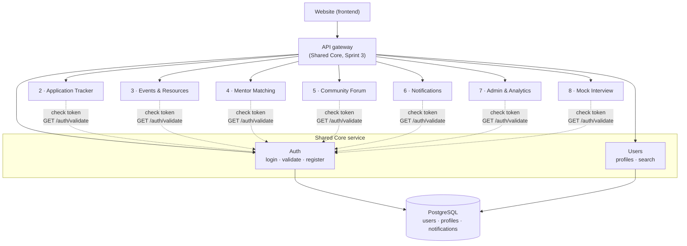
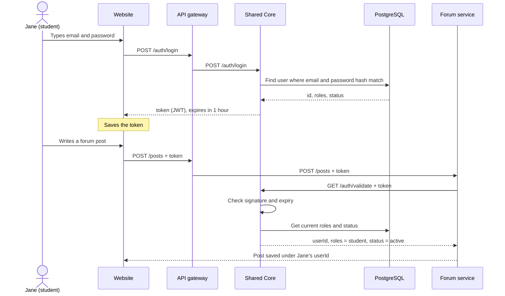
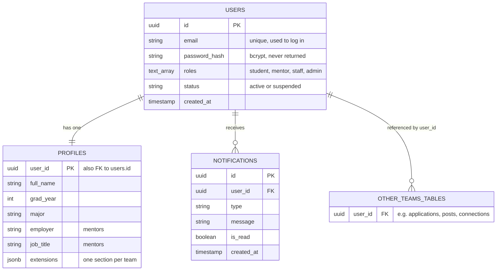

# Shared Core diagrams

Three diagrams that explain how Shared Core fits into Mason CareerLaunch.

## 1. Architecture: where Shared Core sits

Every request from the website goes through the **API gateway**. Each subsystem checks the user's token with **Shared Core's auth service**. Only Shared Core reads and writes the shared user tables.

## 2. Login and token check: what happens step by step

Example: Jane logs in, then writes a forum post. Login happens **once**; the token check happens on **every** request after that.

If the password is wrong, login returns **401**. If the token is fake, changed, or expired, validate returns **401**. If the account is suspended, both return **403**.

## 3. Shared data model (v1)

The tables Shared Core owns. Other teams' tables store a `user_id` that points to `users.id`; they never copy names or emails.

Source of truth for the tables: `db/migrations/` in the Shared Core repo. After Sprint 2, any change requires written notice to all teams.
