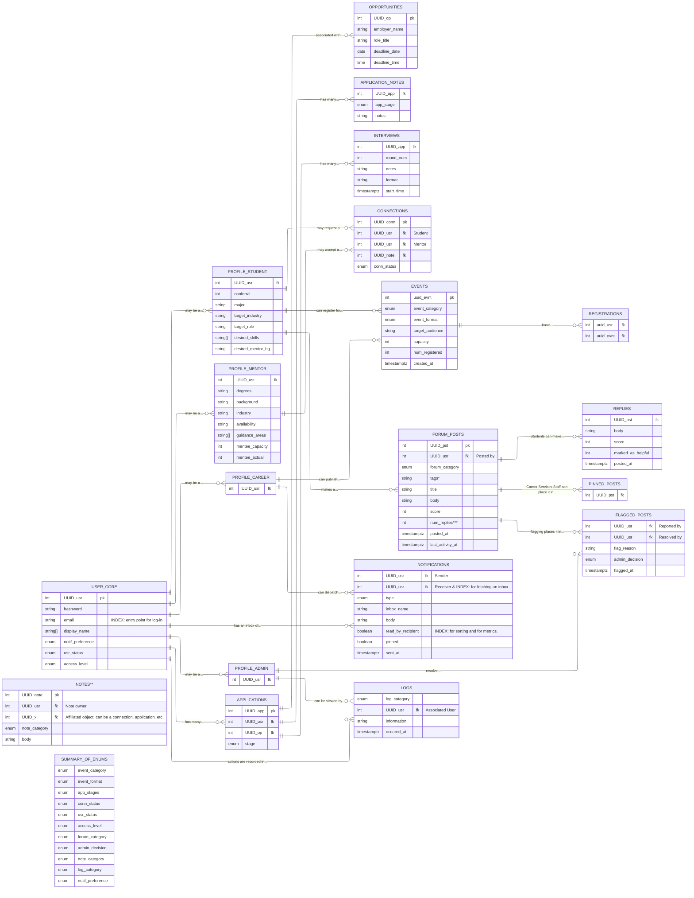

# <div align=center> SECTION III: Database Design </div>

> This section summarizes the design and relationships of the database. Please review the design and inform us immediately if certain subsystem features are not feasible under our design.


### Footnotes
*tags ideally are stored in one string, separated by commas for database storage.

**to facilitate the numerous free-form note-taking features of the platform, we are evaluating a better way to store these notes.

***rates are currently designed as numerical (i.e., "15 average replies per post" rather than "8 replies an hour). Let us know if this poses problems.

## Recognized Functionalities
```
This section is being expanded in Sprint 4!
```

- An inbox can be built by querying the notifications table by recipient.
- "Usage analytics: Aggregate, anonymized metrics about platform usage, new registrations by week, active users by subsystem, applications logged and stage-progression rates, events created and registration rates, forum posts and reply rates, mentor connections initiated and completed, notifications sent and opened. Presented as a dashboard with basic visualizations. Not individual user tracking — aggregate statistics only. This is the metric set that would let Career Services staff actually see whether the platform is working," (Canvas).
    - Registrations can be logged and given a specific category.
    - Logs will reflect typical activity, which can ideally be referenced for user activity by subsystem.
    - Application metrics doable.
    - Forum posts and reply rates doable, but see footnote *** above.
    - Events and registration metrics doable; query EVENTS "created_at" and "num_registered" fields.
    - Mentor connections doable.
    - Notifications doable; query NOTIFICATIONS "read_by_recipient" field.
